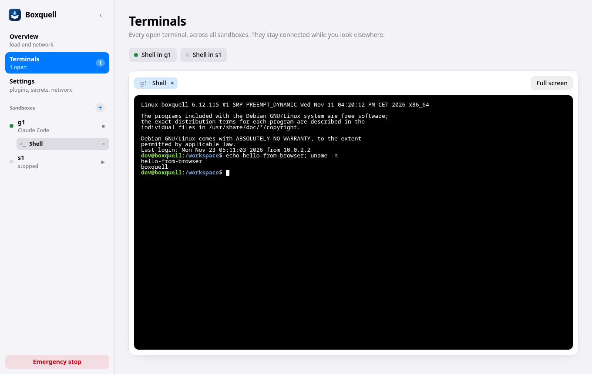
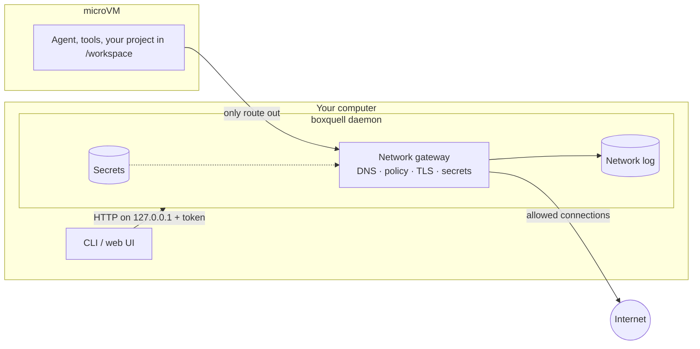

<p align="center">
  
</p>

<h1 align="center">Boxquell</h1>

<p align="center">
  <b>Run coding agents in microVMs where every network connection has to be allowed, and every attempt is logged.</b><br>
  No account, no cloud service. Your API keys never enter the sandbox.
</p>

<p align="center">
  <a href="https://github.com/Boxquell/boxquell/actions/workflows/ci.yml"></a>
  
  
</p>

<p align="center">
  
</p>

<p align="center">
  
</p>

## Why

Coding agents such as Claude Code, Codex, opencode or pi run commands on your machine, read your files and talk to the internet. Boxquell gives each of them its own small virtual machine:

- **A real VM boundary.** Each sandbox is a microVM (libkrun or QEMU) with its own kernel, not a container sharing yours.
- **Network closed by default.** A sandbox reaches only what you allow: names, wildcards, IP addresses or networks. Or flip it to a blacklist.
- **A log of everything.** Each DNS lookup and connection attempt is recorded with destination, verdict, rule, bytes and duration.
- **Keys stay on the host.** The sandbox sees a placeholder. The real key is put into the request on its way out, and only towards the hosts it belongs to.
- **One place for all of them.** A CLI, a terminal form and a web UI with a terminal in the browser manage any number of sandboxes.

## Status

Boxquell is in early development. It is built and tested on **Linux** (x86_64, KVM). The code is written for macOS and Windows too, and CI builds it there, but nobody has run a sandbox on those systems yet. Expect rough edges and breaking changes.

## Install

```sh
curl -fsSL https://github.com/Boxquell/boxquell/releases/latest/download/install.sh | sh    # Linux, macOS
brew install boxquell/tap/boxquell                                                           # Homebrew
irm https://github.com/Boxquell/boxquell/releases/latest/download/install.ps1 | iex          # Windows (PowerShell)
```

The scripts download the latest release, check it against the release's checksums and install the `boxquell` command and the desktop app for your user (application menu on Linux, Applications on macOS, Start menu on Windows); they tell you what else your computer needs. `--no-desktop` (`-NoDesktop` on Windows) installs the command alone. When something is missing (libkrun or QEMU, an SSH client, access to KVM), the script shows the commands for your package manager and asks whether to run them; `--deps` runs them without asking, `--no-deps` never. Then:

```sh
boxquell doctor
boxquell new mybox --workspace .     # downloads the Debian system on first use
boxquell shell mybox
```

## Build from source (Linux)

You need KVM, an OpenSSH client, git, Docker (only to build the guest image), Rust and Node.js. For the default backend install [libkrun and libkrunfw](https://github.com/containers/libkrun); the `qemu` backend needs `qemu-system-x86_64` instead.

```sh
git clone https://github.com/Boxquell/boxquell && cd boxquell
(cd ui && npm ci && npm run build)        # the web UI is embedded into the binary
cargo build --release
export PATH="$PWD/target/release:$PATH"

boxquell doctor              # checks KVM, libkrun, QEMU and ssh
```

Create a sandbox for a project and start an agent in it:

```sh
boxquell secret set anthropic                  # stored on the host, asked for interactively
boxquell new mybox --workspace . --with claude,python@3.13
boxquell run mybox claude
```

Or pick everything in a form (`boxquell new`), or use the desktop app (below). `boxquell ui` opens the app; to use a web browser instead, switch that on with `boxquell config browser-ui on`.

> **Documentation:** the [wiki](https://github.com/Boxquell/boxquell/wiki) has guides for installation, sandboxes, the network rules, secrets, the software catalogue and writing recipes.

### Desktop app

The desktop app is a window of its own that shows the same interface as `boxquell ui`. It finds the running daemon or starts one. Closing the window leaves Boxquell in the system tray, with a menu to open it again or quit. The installers above put it into the application menu; releases also carry the packages on their own (AppImage and .deb, a macOS app, a Windows installer).

To build it from a checkout (`apps/desktop`, a small Tauri app):

```sh
(cd apps/desktop && npm install && npx tauri build --no-bundle)
scripts/install-desktop-entry.sh        # Linux: adds this build to the application menu
```

Shell completion for bash, zsh, fish and PowerShell:

```sh
boxquell completions fish > ~/.config/fish/completions/boxquell.fish
boxquell completions bash > ~/.local/share/bash-completion/completions/boxquell
```

## What you can do

| | |
|---|---|
| **Sandboxes** | `new --os`, `up`, `down`, `pause`, `resume`, `rm`, `ls`, `shell`, `run`, `set --cpus --ram --disk --workdir --autostart`, `os ls\|build` |
| **Network** | `allow`, `deny`, `unrule`, `policy`, `mode whitelist\|blacklist`, `global allow\|deny`, `lockdown on\|off`, `logs -f --blocked` |
| **Secrets** | `secret set\|ls\|rm\|attach`, per sandbox with `--sandbox` |
| **Software** | `add <box> <recipes…> [--again]`, `remove <box> <recipes…>`, `recipes` |
| **MCP** | `mcp [--read-only] [--allow-network-rules] [--allow-delete]`: a Model Context Protocol server for assistants on this computer |
| **SSH keys** | `ssh-keys [name] --add <file>\|--rm <file>\|--agent on\|off`, for all sandboxes without a name |
| **Agents** | `run <sandbox> claude`, `agent set\|show\|skill-add\|skill-rm`, `set --env KEY=value` |
| **Software** | `recipes`, `add <sandbox> claude node@22 …`, `repo add\|ls\|update\|rm` |
| **Access** | `ssh-config --install`, `port add <sandbox> 8080:3000`, `share add <sandbox> ~/data /mnt/data`, `ui`, `claude-settings`, `config` |

### SSH, VS Code and JetBrains

```sh
boxquell ssh-config --install      # once: writes ~/.ssh/boxquell_config and includes it
ssh boxquell-mybox
```

Every sandbox is then an ssh host named `boxquell-<name>`, started on demand. VS Code (Remote-SSH), VSCodium (Open Remote - SSH) and JetBrains Gateway connect to that host; `scp` and `rsync` work too. Each sandbox has its own key, and the connection never leaves your computer.

### Operating systems

```sh
boxquell os ls                 # debian (default), ubuntu, alpine, and what you added
boxquell new mybox --os ubuntu # downloads the system on first use
boxquell os build ubuntu       # or build it yourself; needs Docker
```

Systems are definitions in a repository, like recipes: a container image plus a setup script, built into a disk image. The official ones live in [boxquell-os](https://github.com/Boxquell/boxquell-os), which also publishes them ready-made for x86_64 and ARM64; boxquell downloads those and checks them against their checksums, so no Docker is needed. Recipes say which systems they support; Debian runs all of them, Ubuntu most, Alpine none yet. Only systems that bring a kernel (Debian) run on the qemu backend.

### Network rules

```sh
boxquell allow mybox example.com            # one name
boxquell allow mybox '*.example.com:443'    # subdomains, one port
boxquell allow mybox 192.168.1.20:5432      # an address in your network
boxquell deny  mybox 10.0.0.0/8             # a whole network
boxquell mode  mybox blacklist              # allow everything public except what is denied
boxquell global deny tracker.example        # for every sandbox
boxquell logs mybox -f --blocked            # watch what gets refused
```

The first matching rule wins, and address rules are checked before name rules. Private and local addresses (your LAN, the host itself) stay closed in both modes until a rule names them. In whitelist mode a connection must go to an address that an allowed name resolved to, and the name a client presents (TLS SNI, HTTP Host) must match, so an allowed address cannot be used to reach a different site.

### Emergency stop

```sh
boxquell lockdown on     # every sandbox loses the network at once; open connections stop carrying data
boxquell lockdown off
```

The web UI has the same switch in its sidebar. A lockdown survives a restart of the daemon.

### Monitoring and notifications

The web UI opens on an overview of all sandboxes: CPU, memory, disk, network throughput and the number of allowed and blocked connections. Each sandbox shows the same for itself. When a connection is blocked you get a desktop notification and a message in the UI with a button to allow the destination; both can be switched off (`boxquell config`). Boxquell also warns when an installed agent has no credential.

### Secrets

```sh
boxquell secret set openai                                  # shared, attach it to sandboxes
boxquell secret set my-api --sandbox mybox --host api.example.com --env MY_API_KEY
```

Inside the sandbox `MY_API_KEY` holds a placeholder. Boxquell terminates TLS for exactly the hosts that have a secret, replaces the placeholder in the request headers and forwards the request. Every other connection passes through untouched.

### Instructions, skills and MCP servers for the agents

```sh
boxquell agent set --instructions rules.md --mcp servers.json      # for every sandbox
boxquell agent skill-add ~/.claude/skills/my-skill
boxquell agent set --sandbox mybox --instructions project-rules.md # on top, for one sandbox
```

A sandbox gets the global set with its own on top. Instructions arrive as `CLAUDE.md` for Claude Code and `AGENTS.md` for Codex, opencode and pi; skills go to `~/.claude/skills` and `~/.agents/skills`; MCP servers are registered with Claude Code and written to `~/.config/boxquell/mcp.json` for other agents. The web UI has the same under Settings → Agents and in each sandbox's Agent tab.

### LLM gateways such as LiteLLM

```sh
boxquell claude-settings mybox settings.json
```

The file is a Claude Code settings file, for example with `ANTHROPIC_BASE_URL`, `ANTHROPIC_AUTH_TOKEN` and model names. The sandbox receives it as its managed settings with the token replaced by a placeholder, the token becomes a secret of that sandbox, and the gateway is added to the allowed destinations. A gateway on your own computer (`localhost`) is reachable from the sandbox as `10.0.2.2`. A key helper in the settings (`apiKeyHelper`, e.g. for a token from a company sign-in) keeps running on your computer: Boxquell calls it, refreshes the key before it runs out and puts it into the requests; the sandbox only has a placeholder. Without a file name, `boxquell claude-settings mybox` takes this computer's managed settings, drop-in files included.

### Usage and costs

Requests that carry one of your keys pass through Boxquell, so it can read from the answer how many tokens they used. The **Usage** page of the app shows tokens per hour or day, sums per key, sandbox and model, and an estimated cost. The estimate comes from a price list you can edit (it ships with the providers' list prices of 23 November 2026); discounts, batch prices and long prompts are not in it. Per key you can set a limit per day in dollars or tokens: once it is reached, requests with that key are answered by Boxquell with "limit reached" until the next day (UTC).

Answers are read uncompressed, and only for requests that carry a key Boxquell keeps. An agent that signs in another way, for example with its own login, is not counted.

### Project file

```toml
# boxquell.toml, in the project folder
software = ["claude", "node@24", "git"]
allow = ["registry.npmjs.org", "github.com"]
read = ["docs.example.com"]
ports = ["3000"]

[env]
NODE_ENV = "development"
```

```sh
boxquell up            # in the project folder: creates the sandbox from the file (after asking) and starts it
boxquell init          # writes boxquell.toml from the sandbox that has this folder as its project folder
```

The file can also set `name`, `os`, `cpus`, `memory`, `disk`, `mode`, `deny`, `workdir`, `autostart`, `secrets` (names only, values stay on your computer), `idle_stop`, `upload_limit` and `download_limit`. Before a sandbox is created from a file, `boxquell up` shows what it asks for, because the file may come with a project someone else wrote. A sandbox that exists gets what the file names and it lacks; nothing is taken away. In the app, choosing a project folder with a `boxquell.toml` offers to use it.

### Finer network rules

```sh
boxquell allow mybox registry.npmjs.org --for 2h     # the rule ends by itself (30m, 2h, 1d)
boxquell read mybox docs.example.com                 # reading only: GET, HEAD and OPTIONS go through, POST and the like do not
boxquell set mybox --upload-limit 200                # cut the network off after 200 MiB sent in one run
```

A read-only rule works for websites: Boxquell looks into the requests, which for HTTPS means it answers with a certificate of the sandbox's own authority (the sandbox trusts it). Other kinds of connection to a read-only destination are refused, because they cannot be checked. Data limits count what passes to and from destinations outside, not the terminal or the project folder; when one is reached, the sandbox is cut off and the interface offers to let it continue.

### Snapshots and templates

```sh
boxquell snapshot take mybox before the refactoring   # keep the disk as it is now
boxquell snapshot ls mybox
boxquell snapshot restore mybox s1795462697           # go back; what happened since is gone
boxquell template save mybox node-project             # a starting point for new sandboxes
boxquell new other --template node-project            # starts with its system and software
```

A snapshot covers the sandbox's own disk: installed software, settings, everything outside the project folder. The project folder lives on your computer and is not part of it. A running sandbox is stopped for the copy and started again. On file systems that can share data between files (btrfs, XFS, APFS) a snapshot takes a moment and no extra space.

### MCP server

```sh
claude mcp add boxquell -- boxquell mcp      # or any other MCP client: command `boxquell`, argument `mcp`
```

`boxquell mcp` lets an assistant on your computer work with sandboxes through the Model Context Protocol: create one, run commands in it, install software, read the network log. Changing network rules and deleting sandboxes are off unless you start it with `--allow-network-rules` or `--allow-delete`; secrets have no tool at all. See [docs/mcp.md](docs/mcp.md).

### SSH keys for git

```sh
boxquell ssh-keys --add ~/.ssh/id_ed25519        # every sandbox may sign with this key
boxquell ssh-keys mybox --agent on               # this sandbox may use everything in your SSH agent
boxquell allow mybox github.com:22               # git over SSH needs the port allowed
```

The private keys never enter a sandbox. Each sandbox gets an agent socket (`SSH_AUTH_SOCK`) that leads back to this computer, where the signing happens: the sandbox can use a key while it runs, but cannot read or copy it. Key files with a passphrase work through your own SSH agent (`ssh-add`, then `--agent on`). Changes apply at once, also to running sandboxes. Not available on Windows yet.

### Plugins

Agents, languages and tools are **recipes**: a small TOML file with an install script and the network destinations it needs. Boxquell ships none itself. Recipes live in git repositories, and on first use boxquell adds the official ones:

| Repository | Recipes |
|---|---|
| [boxquell-agents](https://github.com/Boxquell/boxquell-agents) | Claude Code, Codex, opencode, pi, Orca server |
| [boxquell-languages](https://github.com/Boxquell/boxquell-languages) | Node.js, Python, Go, Rust, PHP, with selectable versions (`node@22`) |
| [boxquell-tools](https://github.com/Boxquell/boxquell-tools) | C/C++ build tools, Git, GitHub CLI, jq, ripgrep, Composer, Docker, code-server, network access for VS Code Remote and JetBrains Gateway |
| [boxquell-os](https://github.com/Boxquell/boxquell-os) | Debian, Ubuntu, Alpine |

Add your own or other people's repositories next to them:

```sh
boxquell repo add https://example.com/someone/boxquell-extras
boxquell add mybox extras:some-tool
boxquell repo update
```

A recipe is named `<repository>:<recipe>`; the short name works when it is unambiguous, and the official repositories win, so another repository cannot take over a name like `claude`. Recipes run their own scripts inside the sandbox and open the destinations they list, so add only repositories you trust. The format is described in [docs/recipes.md](docs/recipes.md).

## How it works



- The guest has a single network device. Its other end is a user-space network stack inside the daemon, so there is no route around the policy.
- DNS is answered by the daemon. Names that are not allowed do not resolve.
- The project folder is shared into the guest at `/workspace`; the rest of your files are not visible.
- The daemon listens on `127.0.0.1` only, and every API request needs a token that is stored in a file readable by you alone.

## Limits you should know

- macOS and Windows are untested. Pausing works on Linux and macOS only.
- The `qemu` backend does not share folders yet.
- A read-only shared folder guards against accidents; root inside the sandbox can remount it writable.
- The web UI can be opened on other network addresses (Settings), but that connection is not encrypted. Use it only in networks you trust.
- Secrets are stored in a file with owner-only permissions, not in the system keychain yet.
- The guest is IPv4-only, and UDP other than DNS is refused (so no QUIC; clients fall back to TCP).
- Most recipes target Debian; Ubuntu runs those marked for it, Alpine has none yet.
- Docker in a sandbox runs without its own network bridge: containers need `--network host`.

## Releases

Release binaries are built by GitHub Actions from version tags, with a `SHA256SUMS` file, a software bill of materials (CycloneDX) and build provenance (`gh attestation verify <file> --repo Boxquell/boxquell`). The macOS and Windows binaries are signed once the certificates are configured; see [docs/release-signing.md](docs/release-signing.md). Security reports: [SECURITY.md](SECURITY.md).

## Development

```sh
scripts/boxquell-dev …        # runs target/debug/boxquell with ./.boxquell-dev as data directory
cargo test --workspace
(cd ui && npm run dev)        # needs BOXQUELL_API=http://127.0.0.1:<port> of a running daemon
scripts/third-party-notices.sh
```

The workspace: `apps/desktop` (Tauri window, built separately), `boxquell-net` (gateway, policy, interception), `boxquell-vm` (libkrun and QEMU), `boxquell-core` (configuration, secrets, recipes, log), `boxquell` (CLI, daemon, API), `ui` (React), `image` (the scripts every guest runs).

## License

Licensed under either of [Apache License 2.0](LICENSE-APACHE) or [MIT license](LICENSE-MIT) at your option. Third-party components are listed in [THIRD-PARTY-NOTICES.md](THIRD-PARTY-NOTICES.md).
