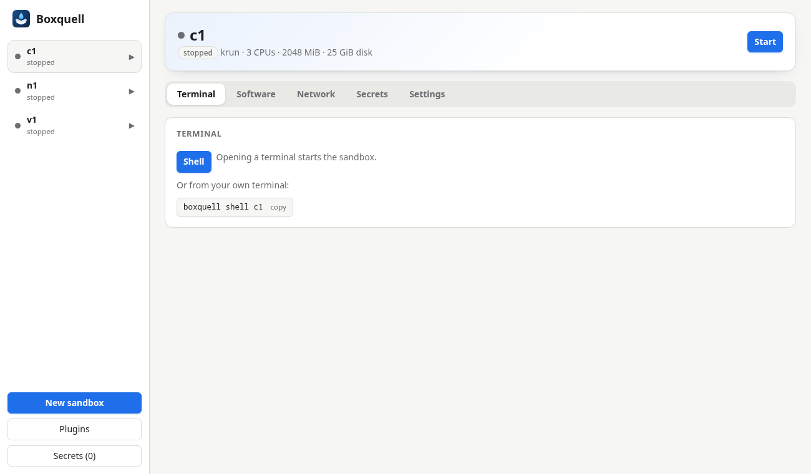
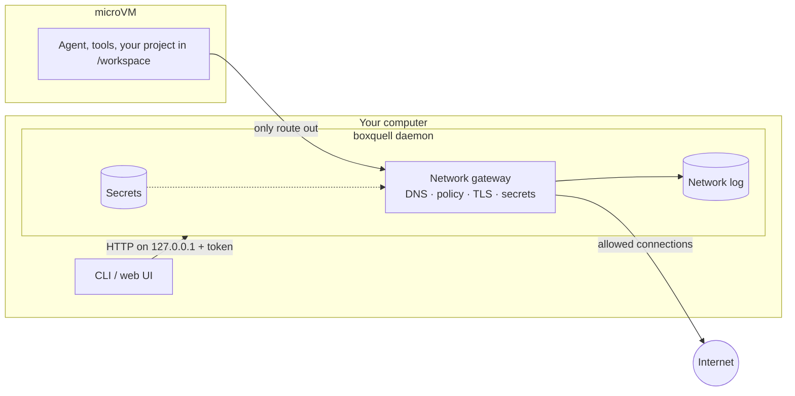

<p align="center">
  
</p>

<h1 align="center">Boxquell</h1>

<p align="center">
  <b>Run coding agents in microVMs where every network connection has to be allowed, and every attempt is logged.</b><br>
  No account, no cloud service. Your API keys never enter the sandbox.
</p>

<p align="center">
  <a href="https://github.com/ToBee94/boxquell/actions/workflows/ci.yml"></a>
  
  
</p>

<p align="center">
  
</p>

## Why

Coding agents such as Claude Code, Codex, opencode or pi run commands on your machine, read your files and talk to the internet. Boxquell gives each of them its own small virtual machine:

- **A real VM boundary.** Each sandbox is a microVM (libkrun or QEMU) with its own kernel, not a container sharing yours.
- **Network closed by default.** A sandbox reaches only what you allow: names, wildcards, IP addresses or networks. Or flip it to a blacklist.
- **A log of everything.** Each DNS lookup and connection attempt is recorded with destination, verdict, rule, bytes and duration.
- **Keys stay on the host.** The sandbox sees a placeholder. The real key is put into the request on its way out, and only towards the hosts it belongs to.
- **One place for all of them.** A CLI, a terminal form and a web UI with a terminal in the browser manage any number of sandboxes.

## Status

Boxquell is in early development. It is built and tested on **Linux** (x86_64, KVM). The code is written for macOS and Windows too, and CI builds it there, but nobody has run a sandbox on those systems yet. Expect rough edges and breaking changes.

## Quick start (Linux)

You need KVM, an OpenSSH client, git, Docker (only to build the guest image), Rust and Node.js. For the default backend install [libkrun and libkrunfw](https://github.com/containers/libkrun); the `qemu` backend needs `qemu-system-x86_64` instead.

```sh
git clone https://github.com/ToBee94/boxquell && cd boxquell
(cd ui && npm ci && npm run build)        # the web UI is embedded into the binary
cargo build --release
export PATH="$PWD/target/release:$PATH"

image/build.sh ~/.local/share/boxquell/images/base.img   # Debian guest image, once
boxquell doctor                                           # checks KVM, libkrun, QEMU, ssh, image
```

Create a sandbox for a project and start an agent in it:

```sh
boxquell secret set anthropic                  # stored on the host, asked for interactively
boxquell new mybox --workspace . --with claude,python@3.13
boxquell run mybox claude
```

Or pick everything in a form (`boxquell new`), or use the browser:

```sh
boxquell ui
```

## What you can do

| | |
|---|---|
| **Sandboxes** | `new`, `up`, `down`, `pause`, `resume`, `rm`, `ls`, `shell`, `run`, `set --cpus --ram --disk` |
| **Network** | `allow`, `deny`, `unrule`, `policy`, `mode whitelist\|blacklist`, `global allow\|deny`, `logs -f --blocked` |
| **Secrets** | `secret set\|ls\|rm\|attach`, per sandbox with `--sandbox` |
| **Software** | `recipes`, `add <sandbox> claude node@22 …`, `repo add\|ls\|update\|rm` |
| **Access** | `port add <sandbox> 8080:3000`, `ui`, `claude-settings` |

### Network rules

```sh
boxquell allow mybox example.com            # one name
boxquell allow mybox '*.example.com:443'    # subdomains, one port
boxquell allow mybox 192.168.1.20:5432      # an address in your network
boxquell deny  mybox 10.0.0.0/8             # a whole network
boxquell mode  mybox blacklist              # allow everything public except what is denied
boxquell global deny tracker.example        # for every sandbox
boxquell logs mybox -f --blocked            # watch what gets refused
```

The first matching rule wins, and address rules are checked before name rules. Private and local addresses (your LAN, the host itself) stay closed in both modes until a rule names them. In whitelist mode a connection must go to an address that an allowed name resolved to, and the name a client presents (TLS SNI, HTTP Host) must match, so an allowed address cannot be used to reach a different site.

### Secrets

```sh
boxquell secret set openai                                  # shared, attach it to sandboxes
boxquell secret set my-api --sandbox mybox --host api.example.com --env MY_API_KEY
```

Inside the sandbox `MY_API_KEY` holds a placeholder. Boxquell terminates TLS for exactly the hosts that have a secret, replaces the placeholder in the request headers and forwards the request. Every other connection passes through untouched.

### LLM gateways such as LiteLLM

```sh
boxquell claude-settings mybox settings.json
```

The file is a Claude Code settings file, for example with `ANTHROPIC_BASE_URL`, `ANTHROPIC_AUTH_TOKEN` and model names. The sandbox receives it as its managed settings with the token replaced by a placeholder, the token becomes a secret of that sandbox, and the gateway is added to the allowed destinations. A gateway on your own computer (`localhost`) is reachable from the sandbox as `10.0.2.2`.

### Plugins

Agents, languages and tools are **recipes**: a small TOML file with an install script and the network destinations it needs. Recipes live in git repositories, and you can add your own or other people's:

```sh
boxquell repo add https://github.com/ToBee94/boxquell-recipes
boxquell add mybox recipes:jq
```

Recipes from a repository are named `<repository>:<recipe>` and can never replace a built-in one. They run their own scripts inside the sandbox and open the destinations they list, so add only repositories you trust. See [boxquell-recipes](https://github.com/ToBee94/boxquell-recipes) for the format.

## How it works



- The guest has a single network device. Its other end is a user-space network stack inside the daemon, so there is no route around the policy.
- DNS is answered by the daemon. Names that are not allowed do not resolve.
- The project folder is shared into the guest at `/workspace`; the rest of your files are not visible.
- The daemon listens on `127.0.0.1` only, and every API request needs a token that is stored in a file readable by you alone.

## Limits you should know

- macOS and Windows are untested. Pausing works on Linux and macOS only.
- The `qemu` backend does not share the project folder yet.
- Secrets are stored in a file with owner-only permissions, not in the system keychain yet.
- The guest is IPv4-only, and UDP other than DNS is refused (so no QUIC; clients fall back to TCP).
- Recipes target the Debian guest image.

## Development

```sh
scripts/boxquell-dev …        # runs target/debug/boxquell with ./.boxquell-dev as data directory
cargo test --workspace
(cd ui && npm run dev)        # needs BOXQUELL_API=http://127.0.0.1:<port> of a running daemon
scripts/third-party-notices.sh
```

The workspace: `boxquell-net` (gateway, policy, interception), `boxquell-vm` (libkrun and QEMU), `boxquell-core` (configuration, secrets, recipes, log), `boxquell` (CLI, daemon, API), `ui` (React), `image` (guest image), `recipes` (built-in recipes).

## License

Licensed under either of [Apache License 2.0](LICENSE-APACHE) or [MIT license](LICENSE-MIT) at your option. Third-party components are listed in [THIRD-PARTY-NOTICES.md](THIRD-PARTY-NOTICES.md).
